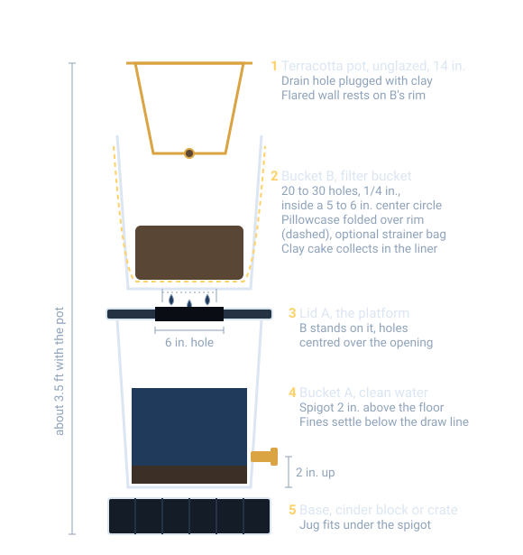
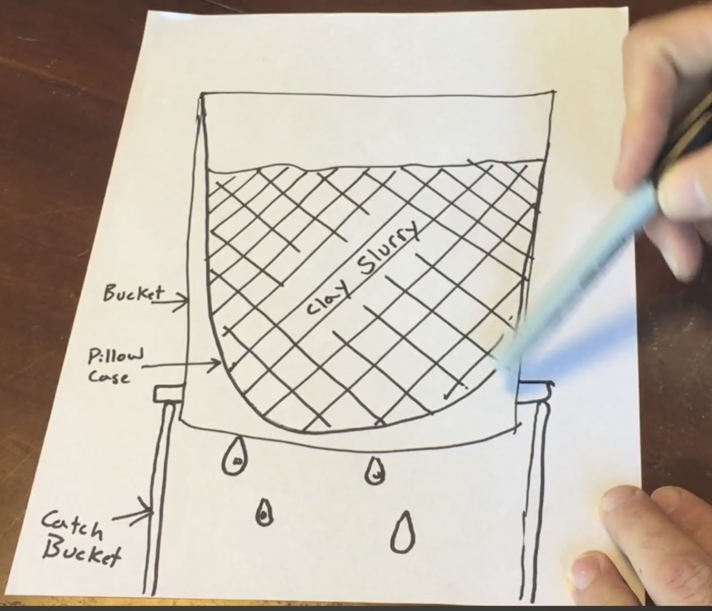
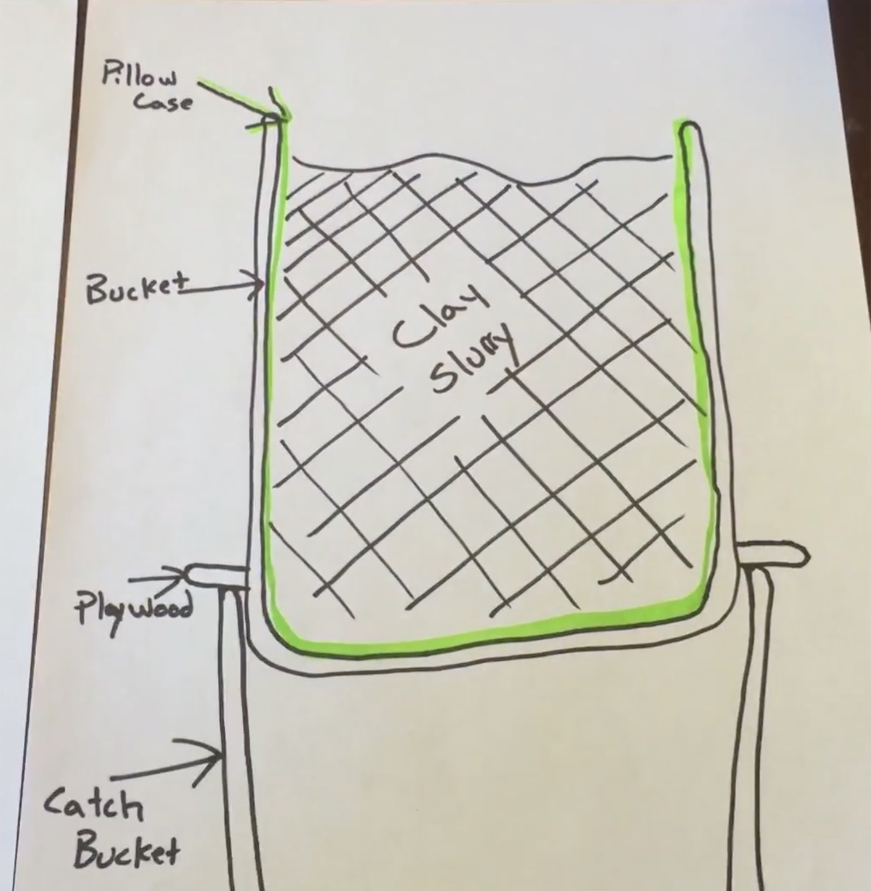

# Vertical Clay Reclaim Stack: Two Buckets, a Pillowcase and a Terracotta Pot

A compact clay reclaim and water filtration system for the studio, built from two 5 gallon buckets stacked entirely vertically so it takes one bucket's footprint. Dirty throwing water goes in the top, clay collects as a filter cake in a pillowcase, and clear water comes out of a spigot at the bottom to go back into the throwing bucket. Nothing from this system goes down a drain.

Earlier versions of this idea: a two-tier bucket filter with a sink drain and a rain barrel spigot (March 2026, the sketches below are from that note, which also floated a car wash grit-trap insert to hold an air gap under the liner), then a three-tote settling cascade that swapped plaster for a hanging pillowcase and then for terracotta dewatering (July 2026). This page combines them into one stack.

## The Stack, Top to Bottom

*Cross section, not to scale; numbers match the tiers below. Flow: dirty water into B, the clay cake stays in the liner, water drips through the lid hole into A, clean water out the spigot. Bucket and pot sizes are nominal, so measure your own before cutting the lid hole.*

Total height with the pot is roughly 3.5 ft. Place it where it cannot get bumped, since a full top bucket is heavy.

### 1. Terracotta pot (optional top tier)

- Unglazed, raw inside and out. No sealer or paint.
- Drainage hole plugged with a wad of your own clay.
- Sits down into the mouth of Bucket B with its flared wall resting on the rim. Most of the outer wall stays in open air, which keeps the evaporation side working.
- Weep water drips into Bucket B instead of onto the floor.
- Lift it off when pouring new dirty water into Bucket B.
- Use: dewater thick slurry moved out of the pillowcase.

### 2. Bucket B (filter bucket)

- 20 to 30 holes, 1/4 inch, drilled in the bottom, kept inside a 5 to 6 inch center circle.
- Lined with a 100% cotton pillowcase folded over the rim.
- Optional: a paint strainer bag underneath the pillowcase for support. Strainer mesh alone is too coarse to stop clay fines.
- Dirty water goes in here. Clay builds up in the pillowcase as a filter cake, which is the reclaim.
- When the cake is thick: move slurry to the terracotta pot, or lift the pillowcase out and hang it.

### 3. Bucket A lid (platform)

- 6 inch hole cut in the center.
- Bucket B sits flat on this lid with its drilled holes centered over the opening.
- The buckets are stacked, not nested, so A keeps its full volume.

### 4. Bucket A (clean water reservoir)

- Spigot installed 2 inches up from the bottom so settled fines stay below the draw line.
- Scoop the settled layer back into the pillowcase every few weeks.

### 5. Base

- Cinder block or milk crate so a jug fits under the spigot.

## Parts List

| Part | Copy/paste name | Qty | Notes |
|---|---|---|---|
| Bucket | `Leaktite 5 Gallon Bucket` | 2 | A is the reservoir, B is the filter bucket. |
| Lid | `Leaktite 5 Gallon Bucket Lid` | 2 | One for A with the 6 inch hole, one to cover B. |
| Spigot | `Renator Brass Rain Barrel Spigot Kit` | 1 | Or any `rain barrel spigot kit with bulkhead fitting`. Mounts 2 inches up from the bottom of A. |
| Filter liner | `100% cotton pillowcases standard size white` | 2 to 3 | Tight weave. No poly blend, no jersey knit. Spares so one is always dry. |
| Support liner (optional) | `5 gallon paint strainer bags fine mesh` | 1 | Goes in before the pillowcase. |
| Dewatering pot (optional) | `unglazed terracotta pot 14 inch` | 1 | Raw inside and out. No sealer or paint. |
| Sealant | `silicone sealant clear waterproof` | 1 | Around the spigot bulkhead. |

## Tools

- Drill with a `1/4 inch bit` for the drain holes in B.
- `Hole saw` matching the spigot kit's bulkhead size.
- Jigsaw or utility knife for the 6 inch lid hole.

## Build Steps

1. **Drill bucket B.** 20 to 30 quarter-inch holes in the bottom, all inside a 5 to 6 inch circle in the center.
2. **Cut the platform lid.** Cut a 6 inch hole in the center of one lid. Snap it onto bucket A.
3. **Install the spigot.** Hole saw through A's wall about 2 inches up from the bottom, fit the bulkhead, seal with silicone, let it cure.
4. **Line B.** Paint strainer bag first if using one, then the pillowcase folded over the rim.
5. **Stack.** Base, then A with the cut lid, then B centered over the hole, then the terracotta pot in B's mouth. Plug the pot's drainage hole with clay.
6. **Run.** Pour dirty water into B (or thick slurry into the pot). Draw clean water from A's spigot into a jug.

## Use Notes

- Clean water from Bucket A goes back to the throwing bucket or rinse. Nothing goes down a drain.
- Flow slows to a drip once the clay cake forms in the pillowcase. That is expected and is what makes it filter so fine.
- Keep the second lid on B when not in use. The March note's point: a lid contains the smell, and popping it daily lets evaporation set how wet the reclaim stays.
- **Wet-handle sludge.** Do not sand or sweep dried clay. The dust is respirable silica.

## Sketches

The two drawings from the March note. Both show the pillowcase tier over a catch bucket, before the platform lid replaced the plywood.

*Pillowcase liner in the top bucket, drips into the catch bucket.*

*Pillowcase folded over the rim, top bucket on a plywood platform. The 6 inch lid hole does the plywood's job in the stack above.*

## Reference Photos

> Note: reference photos go in `data/pottery/img/reclaim-stack/` in the site repo, then one `` line per photo here, then `npm run build:pottery`. Wanted, by category: stacked bucket filters with spigots in a pottery studio; a pillowcase draining clay slurry; a paint strainer bag in a 5 gallon bucket; a spigot mounted low on a 5 gallon bucket; terracotta reclaim (weak examples so far).

Reference links:

- [Two-bucket build with step photos, spigot drilling and mounting (Skillset)](https://skillsetmag.com/article/diy-water-filter/)
- YouTube searches: `easiest clay water filtration system for pottery studios`, `2 bucket method for water waste pottery to the people`, `recycling clay with the pillowcase method`, `terracotta pot clay reclaim`

## Open Questions / To Verify

- `TODO: MEASURE` the spigot kit's bulkhead hole size before buying the hole saw.
- `TODO: TEST` whether a 14 inch pot seats on the rim of the bucket you buy; rim and pot flare vary by brand.
- `TODO: TEST` how many weeks of throwing fill the pillowcase before it needs hanging.
